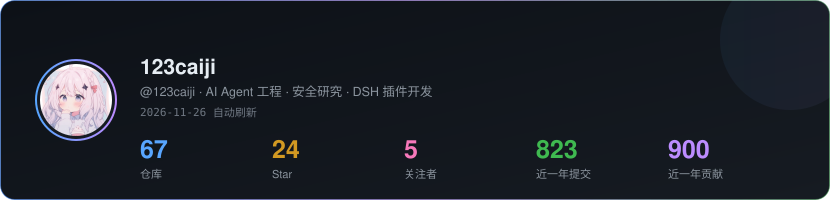
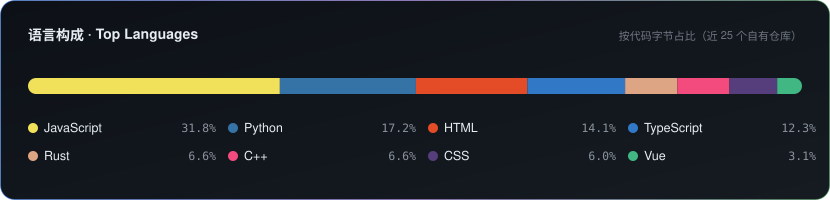

<h1 align="center">123caiji</h1>

  <em>安全 · AI Agent · IoT</em> 
  物联网工程应届，在北京做安全分析实习

  
  
  

<!-- STATS:START -->

公开仓库 49 个 · star 合计 22 · 关注者 5 · 近 7 天提交 113 次 · 近一年贡献 747 次 · 2026-11-21 刷新

<!-- STATS:END -->

<!-- CARDS:START -->

  

  

  

<!-- CARDS:END -->

  <picture>
    <source media="(prefers-color-scheme: dark)" srcset="https://raw.githubusercontent.com/123caiji/123caiji/output/github-contribution-grid-snake-dark.svg" />
    <source media="(prefers-color-scheme: light)" srcset="https://raw.githubusercontent.com/123caiji/123caiji/output/github-contribution-grid-snake.svg" />
    
  </picture>

## 仓库

### 狩猎

| 仓库 | 说明 |
| --- | --- |
| [security-research-toolkit](https://github.com/123caiji/security-research-toolkit) | 侦察到取证，结论落到 file:line |
| [cve-poc](https://github.com/123caiji/cve-poc) | 393 条公开 CVE PoC，每条标复现状态：Full 8 / Partial 28 / Pending 348 / No target 9 |
| [nuclei](https://github.com/123caiji/nuclei) | projectdiscovery，模板化漏洞扫描 |
| [Claude-BugHunter](https://github.com/123caiji/Claude-BugHunter) | 82 个 skill、15 个 slash command、681 条已披露报告模式 |
| [sapper-v2](https://github.com/123caiji/sapper-v2) | 多 agent 自主渗透，事实-意图图 |
| [vero](https://github.com/123caiji/vero) | 证据驱动的红队 agent |
| [chronos](https://github.com/123caiji/chronos) | Go 写的极简 offensive agent，不用 skill / RAG / MCP |
| [ARTEX-contrib](https://github.com/123caiji/ARTEX-contrib) | 多 agent 渗透，每条 finding 绑资产和 HTTP 流量 |
| [Bad-Guy](https://github.com/123caiji/Bad-Guy) | 安全能力知识库，可被 agent 直接调 |
| [Code-Audit](https://github.com/123caiji/Code-Audit) | Java / PHP 白盒审计 skills |
| [term3-lab](https://github.com/123caiji/term3-lab) | Web 攻防靶场，不需要 Docker |
| [CTF-MCP](https://github.com/123caiji/CTF-MCP) | 126 个 Web / Crypto / Pwn 工具的 MCP server |

### 搜索

| 仓库 | 说明 |
| --- | --- |
| [ai-world](https://github.com/123caiji/ai-world) | 61 个源、每 165 分钟一轮的 AI 情报站，每条带来源 |
| [Github-API-scan](https://github.com/123caiji/Github-API-scan) | 扫 GitHub 和本地 git 里泄漏的 AI API key |
| [subfinder](https://github.com/123caiji/subfinder) | 被动子域枚举 |
| [amass](https://github.com/123caiji/amass) | 攻击面测绘 |

### IoT

| 仓库 | 说明 |
| --- | --- |
| [stm32-iot-smart-home](https://github.com/123caiji/stm32-iot-smart-home) | STM32F103 + LoRa + FreeRTOS，带路线图 |
| [kangyang-digital-twin](https://github.com/123caiji/kangyang-digital-twin) | 数字孪生毕设，Vue + MQTT |
| [binwalk](https://github.com/123caiji/binwalk) | 固件解包、镜像识别 |
| [firmware-analysis-toolkit](https://github.com/123caiji/firmware-analysis-toolkit) | 固件仿真和污点追踪 |
| [mqtt-pwn](https://github.com/123caiji/mqtt-pwn) | MQTT broker 渗透 |

### Agent

| 仓库 | 说明 |
| --- | --- |
| [awesome-agent-security](https://github.com/123caiji/awesome-agent-security) | Agent 安全和 DSH 生态精选，每天自动刷 |
| [dsh-live](https://github.com/123caiji/dsh-live) | 会话现场面板：在跑什么、要不要人管、这轮花多少 |
| [dsh-memory-toolkit](https://github.com/123caiji/dsh-memory-toolkit) | Agent 长期记忆，图 + 向量检索 |
| [AI-LLM-Agent-Learning](https://github.com/123caiji/AI-LLM-Agent-Learning) | RAG / MCP / LangGraph 的学习笔记 |
| [hexstrike-ai](https://github.com/123caiji/hexstrike-ai) | 让 agent 自己跑 150 多个安全工具的 MCP server |
| [AutoRedTeam-Orchestrator](https://github.com/123caiji/AutoRedTeam-Orchestrator) | 本地 MCP / AI 攻击面审计，finding 要过证据门禁 |
| [catchclaw](https://github.com/123caiji/catchclaw) | 9 个 AI Agent 平台的安全评估，78 条 DAG 攻击链 |
| [LLM-Security-Assessment-Framework](https://github.com/123caiji/LLM-Security-Assessment-Framework) | FORGEDAN，6 种攻击方法、18 个模型适配器 |
| [coffee-skill](https://github.com/123caiji/coffee-skill) | Codex / AgentSkills 的工作流包 |
| [deepseek-harness](https://github.com/123caiji/deepseek-harness) | DeepSeek Harness 官方实现镜像 |
| [magpie](https://github.com/123caiji/magpie) | 一个入口跑所有模型 |

> 三条线的规矩一样：能复现的输入输出才算证据，工具的 stdout 不算。

只读学习用的镜像：anatomy · craft-anything · kb-graph · DeepInfer · rea · toolkit · manuals · teorias-numeradas · agens-harness · AgentRed · Hexstrike-ai-6.2
