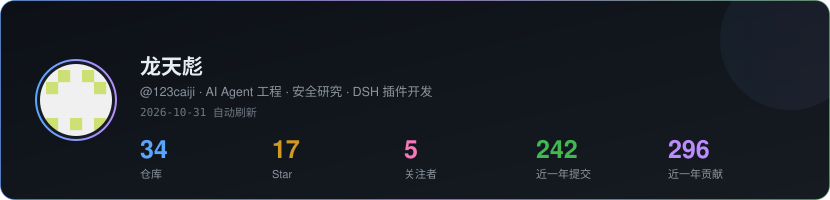
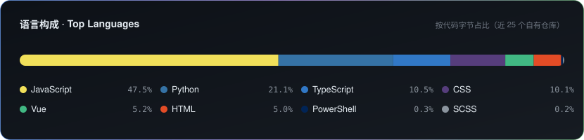
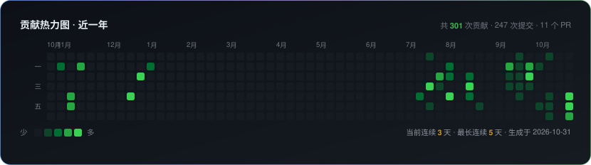

<h1 align="center">你好，我是 龙天彪 <code>123caiji</code></h1>

  <em>AI Agent 工程 · 安全研究 · DeepSeek Harness 插件开发</em>

  
  
  
  

<!-- STATS:START -->

**最近在更新**（2026-10-31 自动刷新）

| 仓库 | 说明 | 最后更新 |
| --- | --- | --- |
| [awesome-agent-security](https://github.com/123caiji/awesome-agent-security) | AI Agent security tooling + DeepSeek Harness plugin ecosystem, curated and auto-refreshed daily by GitHub Actions. | 今天 |
| [123caiji](https://github.com/123caiji/123caiji) | GitHub profile README with live stats and an auto-generated contribution snake. | 今天 |
| [ai-world](https://github.com/123caiji/ai-world) | AI 大世界 · 实时 AI 情报站：新闻/论文/新模型/GitHub 涨星/DSH 插件，61 个数据源每 165 分钟自动扫描（自愈链，无需人管），每条都带可核验来源 | 今天 |
| [kangyang-digital-twin](https://github.com/123caiji/kangyang-digital-twin) | kangyang-digital-twin graduation project | 今天 |
| [dsh-memory-toolkit](https://github.com/123caiji/dsh-memory-toolkit) | Memory and token-optimization plugin toolkit for DeepSeek Harness: cross-session knowledge graph memory + five-layer token-saving orchestration. | 今天 |

公开仓库 34 个 · star 合计 17 · 关注者 5 · 近 7 天提交 93 次 · 近一年贡献 296 次

<!-- STATS:END -->

## 数据

<!-- CARDS:START -->

  

  

  

<!-- CARDS:END -->

<!-- 贪吃蛇：由 .github/workflows/snake.yml 每天生成，写到 output 分支 -->

  <picture>
    <source media="(prefers-color-scheme: dark)" srcset="https://raw.githubusercontent.com/123caiji/123caiji/output/github-contribution-grid-snake-dark.svg" />
    <source media="(prefers-color-scheme: light)" srcset="https://raw.githubusercontent.com/123caiji/123caiji/output/github-contribution-grid-snake.svg" />
    
  </picture>

上面三张卡片由本仓库的 <a href="./scripts/profile-stats.mjs">scripts/profile-stats.mjs</a> 每天用 GitHub API 现算现画（自绘 SVG，存仓库里，不依赖任何第三方图片服务，所以不会破图）；贡献格贪吃蛇由 <a href="https://github.com/Platane/snk">Platane/snk</a> 每天生成。卡片灵感来自 <a href="https://github.com/lowlighter/metrics">lowlighter/metrics</a>。

## 我在做什么

- **DeepSeek Harness（DSH）插件**：[dsh-live](https://github.com/123caiji/dsh-live) 会话现场驾驶舱、[dsh-memory-toolkit](https://github.com/123caiji/dsh-memory-toolkit) Agent 长期记忆与知识图谱
- **AI 安全 / 红队**：[security-research-toolkit](https://github.com/123caiji/security-research-toolkit)，以及精选索引 [awesome-agent-security](https://github.com/123caiji/awesome-agent-security)
- **实时情报**：[ai-world](https://github.com/123caiji/ai-world) —— 61 个数据源每 165 分钟自动扫描的 AI 情报站，每条都带可核验来源
- **学习与笔记**：[AI-LLM-Agent-Learning](https://github.com/123caiji/AI-LLM-Agent-Learning)（RAG / MCP / LangGraph / 提示工程）
- **嵌入式折腾**：[stm32-iot-smart-home](https://github.com/123caiji/stm32-iot-smart-home)（STM32 + LoRa + FreeRTOS）

## 精选仓库

| 仓库 | 一句话 |
| --- | --- |
| [dsh-live](https://github.com/123caiji/dsh-live) | DSH 会话现场驾驶舱：现在在做什么、要不要人管、本轮花了多少 token |
| [dsh-memory-toolkit](https://github.com/123caiji/dsh-memory-toolkit) | 给 Agent 加长期记忆：图记忆 + 向量检索 + token 优化 |
| [ai-world](https://github.com/123caiji/ai-world) | AI 大世界：实时 AI 情报站，新闻 / 论文 / 新模型 / 涨星 / 插件 |
| [awesome-agent-security](https://github.com/123caiji/awesome-agent-security) | AI Agent 安全与 DSH 生态精选清单（每天自动刷新） |
| [security-research-toolkit](https://github.com/123caiji/security-research-toolkit) | Web 安全研究工具箱：侦察、SQLi / SSRF / XSS 验证 |
