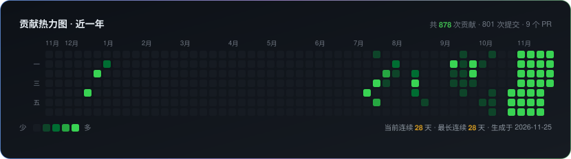

<h1 align="center">你好，我是 <a href="https://github.com/123caiji">123caiji</a></h1>
<p align="center">
  <em>安全 × AI Agent × IoT ｜ 狩猎 · 搜索 · 固件 · Agent</em>
</p>

<p align="center">
  <a href="https://123caiji.github.io/"></a>
  
  <a href="https://123caiji.github.io/ai-world/"></a>
  
</p>

<p align="center">
  <sub>自建的东西在表格第一行，其余是上游项目的只读镜像 —— 每周自动追上游，别在这儿提 PR。</sub>
</p>
<!-- STATS:START -->

**最近在更新**（2026-11-19 自动刷新）

| 仓库 | 说明 | 最后更新 |
| --- | --- | --- |
| [awesome-agent-security](https://github.com/123caiji/awesome-agent-security) | AI Agent security tooling + DeepSeek Harness plugin ecosystem, curated and auto-refreshed daily by GitHub Actions. | 今天 |
| [ai-world](https://github.com/123caiji/ai-world) | AI 大世界 · 实时 AI 情报站：新闻/论文/新模型/GitHub 涨星/DSH 插件，61 个数据源每 165 分钟自动扫描（自愈链，无需人管），每条都带可核验来源 | 今天 |
| [123caiji](https://github.com/123caiji/123caiji) | GitHub profile README with live stats and an auto-generated contribution snake. | 今天 |
| [rea](https://github.com/123caiji/rea) | Mirror of morluto/rea | 6 天前 |
| [kangyang-digital-twin](https://github.com/123caiji/kangyang-digital-twin) | kangyang-digital-twin graduation project | 6 天前 |

<sub>公开仓库 44 个 · star 合计 22 · 关注者 5 · 近 7 天提交 124 次 · 近一年贡献 698 次</sub>

<!-- STATS:END -->

## 数据

<!-- CARDS:START -->

<p align="center">
  
</p>

<p align="center">
  
</p>

<p align="center">
  
</p>

<!-- CARDS:END -->

<!-- 贪吃蛇：由 .github/workflows/snake.yml 每天生成，写到 output 分支 -->
<p align="center">
  <picture>
    <source media="(prefers-color-scheme: dark)" srcset="https://raw.githubusercontent.com/123caiji/123caiji/output/github-contribution-grid-snake-dark.svg" />
    <source media="(prefers-color-scheme: light)" srcset="https://raw.githubusercontent.com/123caiji/123caiji/output/github-contribution-grid-snake.svg" />
    
  </picture>
</p>

<sub>上面三张卡片由本仓库的 <a href="./scripts/profile-stats.mjs">scripts/profile-stats.mjs</a> 每天用 GitHub API 现算现画（自绘 SVG，存仓库里，不依赖任何第三方图片服务，所以不会破图）；贡献格贪吃蛇由 <a href="https://github.com/Platane/snk">Platane/snk</a> 每天生成。卡片灵感来自 <a href="https://github.com/lowlighter/metrics">lowlighter/metrics</a>。</sub>

## 四个方向

> 仓库按方向归口，找东西先看这里。**自建**排在最前，后面是上游镜像（fork，只读，每周 fast-forward）。文末有跨方向的「三条链路」。

### 🎯 狩猎 · Bug Hunting / 红队

| 仓库 | 定位 |
| --- | --- |
| [security-research-toolkit](https://github.com/123caiji/security-research-toolkit) | **自建** 侦察 + SQLi / SSRF / XSS 验证取证，结论落到 file:line |
| [nuclei](https://github.com/123caiji/nuclei) | 上游 projectdiscovery ★33.1k · 模板化漏洞扫描引擎，狩猎的执行层 |
| [cve-poc](https://github.com/123caiji/cve-poc) | 48 条 CVE：Full 8 / Partial 28 / No target 9 / Pending 3，每条钉死上游 commit 并附真终端证据 |
| [Claude-BugHunter](https://github.com/123caiji/Claude-BugHunter) | 82 skills / 15 slash commands / 681 条已披露报告模式，覆盖 24 类漏洞 |
| [sapper-v2](https://github.com/123caiji/sapper-v2) | 自主渗透军团：指挥 agent + worker 集群 + 事实-意图图 |
| [vero](https://github.com/123caiji/vero) | 证据驱动的自主红队 agent |
| [chronos](https://github.com/123caiji/chronos) | 纯 Go 极简 agentic offensive security：0 skill / 0 RAG / 0 MCP |
| [Bad-Guy](https://github.com/123caiji/Bad-Guy) | 结构化安全能力知识库 + Agent 可执行技能 |
| [Code-Audit](https://github.com/123caiji/Code-Audit) | Java / PHP 白盒审计 skills，EVID 证据合约 |
| [ARTEX-contrib](https://github.com/123caiji/ARTEX-contrib) | 多 agent 自主渗透，每条 finding 绑定资产与 HTTP 流量证据 |
| [term3-lab](https://github.com/123caiji/term3-lab) | Web 攻防课程靶场（Python + SQLite，免 Docker） |
| [CTF-MCP](https://github.com/123caiji/CTF-MCP) | 126 个 Web / Crypto / Pwn 工具的 MCP server |

### 🔍 搜索 · 情报搜集 / OSINT

| 仓库 | 定位 |
| --- | --- |
| [ai-world](https://github.com/123caiji/ai-world) | **自建** 61 个数据源 / 每 165 分钟一轮的自愈链情报站，每条带可核验来源 |
| [Github-API-scan](https://github.com/123caiji/Github-API-scan) | 扫 GitHub 与本地 git 里泄漏的 AI API key（50+ 平台），配对 relay 并验证还能不能用 |
| [subfinder](https://github.com/123caiji/subfinder) | 上游 projectdiscovery ★14.8k · 被动子域枚举，采集入口第一步 |
| [amass](https://github.com/123caiji/amass) | 上游 owasp-amass ★15.5k · 深度攻击面测绘与资产发现 |

### 📡 IoT

| 仓库 | 定位 |
| --- | --- |
| [stm32-iot-smart-home](https://github.com/123caiji/stm32-iot-smart-home) | **自建** STM32F103 + LoRa + FreeRTOS，含电路图与 IoT 平台搭建笔记 |
| [kangyang-digital-twin](https://github.com/123caiji/kangyang-digital-twin) | **自建** 数字孪生毕设，Vue + MQTT |
| [binwalk](https://github.com/123caiji/binwalk) | 上游 ReFirmLabs ★14.7k · 固件解包、镜像与签名识别 |
| [firmware-analysis-toolkit](https://github.com/123caiji/firmware-analysis-toolkit) | 上游 attify ★1.6k · 固件二进制分析 + 污点追踪 + 仿真 |
| [mqtt-pwn](https://github.com/123caiji/mqtt-pwn) | 上游 Akamai ★459 · IoT broker 渗透测试，MQTT 协议攻击面 |

### 🤖 Agent · Agent 安全 & DSH 插件

| 仓库 | 定位 |
| --- | --- |
| [dsh-live](https://github.com/123caiji/dsh-live) | **自建** 会话现场驾驶舱：现在在跑什么、要不要人管、这轮花了多少 |
| [dsh-memory-toolkit](https://github.com/123caiji/dsh-memory-toolkit) | **自建** Agent 长期记忆：图记忆 + 向量检索 + token 优化 |
| [awesome-agent-security](https://github.com/123caiji/awesome-agent-security) | **自建** Agent 安全 + DSH 生态精选，每日自动刷新 |
| [AI-LLM-Agent-Learning](https://github.com/123caiji/AI-LLM-Agent-Learning) | **自建** RAG / MCP / LangGraph / 提示工程 |
| [hexstrike-ai](https://github.com/123caiji/hexstrike-ai) | 上游 0x4m4 ★13.7k · MCP server，让 AI agent 自主跑 150+ 安全工具 |
| [AutoRedTeam-Orchestrator](https://github.com/123caiji/AutoRedTeam-Orchestrator) | 本地 MCP / AI 攻击面审计 + 证据门禁，同一步连续三次即停 |
| [catchclaw](https://github.com/123caiji/catchclaw) | 9 个 AI Agent 平台的安全评估，78 条 DAG 攻击链 |
| [LLM-Security-Assessment-Framework](https://github.com/123caiji/LLM-Security-Assessment-Framework) | FORGEDAN：6 种攻击方法 / 18 个模型适配器 |
| [coffee-skill](https://github.com/123caiji/coffee-skill) | Codex / AgentSkills 可验证工作流包 |
| [deepseek-harness](https://github.com/123caiji/deepseek-harness) | DeepSeek Harness 官方实现镜像 |
| [magpie](https://github.com/123caiji/magpie) | 上游 yetone ★37k · 一个入口跑所有模型 |
| [dsh-xiaolong20](https://github.com/123caiji/dsh-xiaolong20) | 🔒 私有：数字分身，人格档案 + 自我记忆 + 可运行 skill |

## 三条链路

把上面四个方向串起来，就是实际干活的三条流水线：

```text
狩猎  目标/域  →  subfinder  →  amass  →  nuclei  →  security-research-toolkit  →  带证据的 finding
IoT   固件镜像  →  binwalk 解包  →  firmware-analysis-toolkit 仿真  →  mqtt-pwn 打 broker  →  设备影子 / 协议面
Agent 模型/客户端  →  catchclaw · AutoRedTeam-Orchestrator  →  攻击链 + 证据门禁  →  修复建议
```

三条链路共用一条硬规则：**没有证据不算结论**。工具的 stdout 不是证据，能复现的输入输出才是。

## 参考（学习用，不常动）

`anatomy` · `craft-anything` · `kb-graph` · `DeepInfer` · `rea` · `toolkit` · `manuals` · `teorias-numeradas` · `agens-harness`

> `AgentRed`、`Hexstrike-ai-6.2` 的上游仓库已删除（孤儿 fork，无法再同步），仅作只读参考；同名能力的活跃版本见上面的 `hexstrike-ai`。

## 这个页面怎么维护的

| 东西 | 频率 | 机制 |
| --- | --- | --- |
| 上方统计表 / 三张卡片 / 贪吃蛇 | 每天 | `scripts/profile-stats.mjs` 用 GitHub API 现算现画，本地 SVG 不外链 |
| fork 镜像 | 每周 | 逐个追上游 fast-forward，失败会在 `awesome-agent-security` 的体检 issue 里点名 |
| 仓库体检（许可证 / 体积 / Wiki / 描述） | 每天 | `account-scan.yml` |
